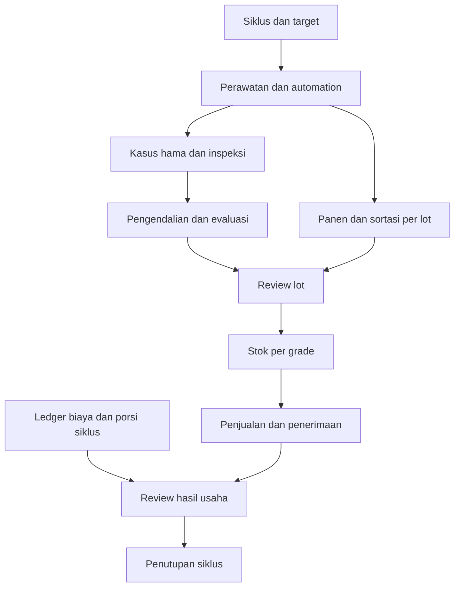

# Siklus tanam sampai hasil usaha

Versi frontend demo, 15 Oktober 2026. Mendukung satu siklus aktif yang sudah ada per greenhouse, dengan panen bertahap dan banyak transaksi. Belum ada pergantian otomatis ke siklus tanam berikutnya atau konsolidasi beberapa siklus.

## Alur yang bisa dijalankan

| Tahap | Perilaku yang tersedia |
|---|---|
| Tanam | Tanggal, tanaman dan jumlah awal dari siklus yang sudah ada. Target tanggal panen, hasil dan harga dapat diatur; bukan hasil prediksi. |
| Perawatan | Jadwalkan pekerjaan per zona, petugas dan tanggal; catat hasil penyelesaian. Tidak membuat pembayaran atau menjalankan perangkat. |
| Automation | Jadwal, resource lock, sensor, proses dan pemakaian tetap menggunakan simulator yang ada; tautan langsung dari siklus. |
| Hama | Kasus dan inspeksi memakai sumber yang sama dengan Detection review. Kasus terbuka pada zona menahan pelepasan dan penjualan lot. |
| Panen | Catat total timbang, grade A, grade B dan reject. Ketiganya harus menjumlah ke total; seluruh lot mulai berstatus ditahan. |
| Review lot | Penanggung jawab mencatat hasil review; kasus terbuka harus selesai terlebih dahulu. Ini bukan sertifikasi mutu atau keamanan konsumsi. |
| Stok | Tersedia per lot dan grade. Penjualan serta susut mengurangi stok. Tidak boleh melebihi stok yang tersedia. |
| Penjualan | Catatan hasil yang sudah diserahkan, pembeli, tanggal, grade, berat, harga dan jatuh tempo. Pesanan belum dikirim tidak dicatat sebagai penjualan. |
| Penerimaan | Dapat bertahap; tidak boleh melebihi sisa tagihan. Penerimaan tidak menambah pendapatan untuk kedua kali. |
| Hasil usaha | Porsi biaya dari ledger, penyusutan dan beban belum dibayar. Piutang, investasi, kas serta tenaga sendiri ditampilkan terpisah. |
| Tutup siklus | Memerlukan catatan panen, stok dan piutang nol, kasus serta tugas selesai, tidak ada run aktif/tidak pasti, dan review biaya valid. Rutinitas aktif dijeda. |

Review ulang siklus mempertahankan catatan dan meminta review biaya baru. Automation tidak aktif lagi secara otomatis. Menjalankan proses tanaman atau mengaktifkan rutinitas dari siklus tertutup ditolak sampai review dibuka.

## Demo presentasi

1. Sebagai Owner/Manager demo, buka **Siklus tanam → Perawatan & hama**. Tetapkan target, tambahkan pekerjaan, kemudian catat hasil perawatan. Buka kasus yang ditampilkan untuk melanjutkan alur inspeksi dan pengendalian lama.
2. Buka **Panen & stok**. Catat panen sendiri atau gunakan **Muat contoh panen & penjualan** jika belum ada lot/transaksi. Tombol ini menjeda simulasi dan tidak mengubah biaya atau kasus lama.
3. Pada fixture awal, contoh menghasilkan satu lot Zona D: total 50 kg, grade A 35 kg, B 12 kg dan reject 3 kg. Penjualan A 25 kg × Rp35.000 = Rp875.000; penerimaan Rp500.000; piutang Rp375.000; stok 22 kg. Seluruh angka sintetis, bukan harga pasar atau prediksi hasil.
4. Bila Zona D sudah memiliki kasus terbuka dari demo sebelumnya, contoh hanya membuat lot ditahan. Selesaikan inspeksi/evaluasi, review lot, lalu catat penjualan. Contoh tidak menghilangkan kasus agar transaksi bisa lolos.
5. Buka **Penjualan**, catat pelunasan atau penjualan sisa stok. Coba jumlah lebih besar dari stok atau penerimaan lebih besar dari sisa tagihan; penyimpanan ditolak.
6. Buka **Biaya & penghematan → Laba siklus → Review biaya siklus**. Tentukan porsi catatan ledger. Biaya baru, termasuk benih/media, kemasan/distribusi dan sewa, dicatat melalui Pengeluaran.
7. Isi penyusutan, tenaga sendiri dan beban belum dibayar. Nilai kosong berarti belum diketahui; 0 hanya untuk biaya yang memang tidak ada. Konfirmasi kelengkapan sesuai data contoh. Jangan menganggap fixture September mencakup seluruh biaya sejak Agustus tanpa review.
8. Lihat perhitungan hasil usaha dan ekspor CSV. Untuk menutup siklus, selesaikan seluruh pekerjaan, kasus, stok, tagihan serta review biaya. Panel penutupan menyebutkan yang masih terbuka.

## Perhitungan dan batasnya

**Neraca hasil:** total panen = reject saat sortasi + susut setelah sortasi + jumlah terjual + stok tersisa. Berat disimpan sampai tiga angka desimal; nilai transaksi dibulatkan ke Rupiah bulat.

**Penjualan:** jumlah berat terjual × harga per kg, dijumlahkan dari transaksi yang belum dibatalkan. Hasil panen yang belum terjual tidak menjadi pendapatan.

**Piutang:** nilai penjualan − penerimaan. Penerimaan merupakan record terpisah yang menunjuk penjualan. Penjualan tanpa penerimaan dapat dibatalkan untuk koreksi; stok grade terkait dikembalikan. Transaksi dengan penerimaan tidak bisa dibatalkan karena retur/refund belum didukung.

**Beban siklus:** pengeluaran operasional berstatus paid × porsi siklus + penyusutan siklus + biaya terpakai yang belum dibayar. Tagihan asal hanya dihitung satu kali; alokasi pompa dan perangkat lain tidak ditambahkan lagi. Porsi siklus adalah pembebanan yang direview pengguna, bukan alokasi otomatis berdasarkan runtime atau luas.

Review biaya juga menyediakan pembayaran sebelum tanggal tanam untuk biaya benih dan persiapan. Semua catatan greenhouse sampai tanggal review tersedia; pembayaran dari siklus lain harus diberi 0%. Tidak ada asumsi bahwa seluruh histori greenhouse menjadi biaya siklus saat ini.

**Hasil sementara:** penjualan − beban siklus. Seluruh biaya siklus dibebankan saat ini; stok tidak diberi nilai akuntansi. Selama panen masih berlangsung atau review belum lengkap, hasil ini tidak boleh disamakan dengan laba bersih final. Setelah estimasi tenaga sendiri tersedia, sistem juga memperlihatkan hasil ekonomi setelah biaya tenaga sendiri, tanpa menguranginya lagi dari kas.

**Arus kas porsi siklus:** penerimaan − pengeluaran operasional yang dialokasikan − investasi yang dialokasikan. Penyusutan dan biaya belum dibayar tidak mengurangi kas. Nilai ini bukan saldo bank dan tidak melakukan pembayaran.

**Pembanding penghematan:** acuan biaya siklus tanpa sistem − beban siklus yang direview. Pendapatan yang sama digunakan untuk membandingkan hasil sebelum/sesudah. Selisih biaya sudah tercermin pada hasil usaha; tidak ditambahkan lagi. Acuan bersifat asumsi, perlu cakupan tanaman, durasi, area dan beban yang sebanding, dan tidak membuktikan dampak kausal Vigor.

Contoh uji dengan biaya operasional Rp1.080.000, penyusutan Rp120.000, beban belum dibayar Rp50.000 dan penjualan Rp875.000: beban Rp1.250.000, hasil sementara −Rp375.000. Jika acuan biaya Rp1.600.000, selisih Rp350.000 tidak mengubah hasil menjadi −Rp25.000. Penerimaan Rp500.000 menghasilkan kas porsi siklus −Rp580.000 sebelum investasi, dan piutang Rp375.000.

Pembelian aset masuk arus kas; hanya porsi penyusutannya menjadi beban hasil usaha. Saat biaya belum dibayar akhirnya dicatat sebagai pembayaran ledger, pengguna harus menyesuaikan beban belum dibayar agar tidak didobel. Edit, void atau penambahan catatan biaya membatalkan status review dan pembanding penghematan sampai direview ulang.

Pemisahan pengukuran berbasis kas dan beban nonkas mengikuti prinsip umum laporan usaha tani; aplikasi ini bukan implementasi laporan akuntansi/pajak resmi. Referensi konsep: https://ers.usda.gov/topics/farm-economy/farm-sector-income-finances/highlights-from-the-farm-income-forecast (bagian perbedaan net cash farm income dan net farm income). Angka contoh aplikasi tidak bersumber dari laporan tersebut.

## Data, akses dan validasi

`DomainState.production` bersifat opsional untuk migrasi state lama. Membuka versi baru tidak membuat hasil panen atau penjualan rekaan. Setiap greenhouse menyimpan catatannya sendiri. Record memiliki kunci submission untuk mencegah duplikasi. Status pembatalan tidak menghapus riwayat. Activity menunjuk lot atau penjualan yang relevan.

Operator dapat mencatat perawatan, panen dan susut. Owner/Manager mengatur target, mereview lot/siklus dan keuangan. Viewer membaca. UI dan action dispatcher menggunakan matriks permission yang sama; seluruhnya tetap simulasi frontend, bukan otorisasi server.

142 tes Vitest mencakup 40 tes siklus/keuangan, termasuk validasi berat/tanggal, stok, piutang, porsi biaya, investasi, savings tanpa penghitungan ganda, hidrasi, greenhouse, closure dan permission. Delapan regresi DOM tambahan mencakup empat ukuran viewport, alur form perawatan → panen → review → penjualan → penerimaan, review biaya, Viewer dan kasus yang menahan lot. Suite domain lama 55 tes tetap dijalankan.

TypeScript dan build produksi diverifikasi pada source Sites. Browser QA, screenshot, chart sizing, native dialog focus, origin persistence dan WebGL belum tersedia karena skill control-browser tidak tersedia di managed environment. DOM tests tidak memvalidasi layout. Tidak ada dependency baru, model ML, perangkat nyata, pembayaran, backend atau koneksi bank.

## Zona dan batch (15 Oktober 2026)

Detail tanaman kini dikelola pada Greenhouse → Zona & tanaman. Setiap zona memiliki satu batch aktif dan riwayat batch selesai. Perawatan dan panen menyimpan asal batch; lot mempertahankan komoditas/varietas saat replanting. Akhiri seluruh batch sebelum menutup siklus: catat pengurangan populasi, selesaikan tugas/kasus, jeda rutinitas zona. Penghematan tetap tidak ditambahkan lagi ke laba. Lihat ZONES_AND_PLANTS.md.
